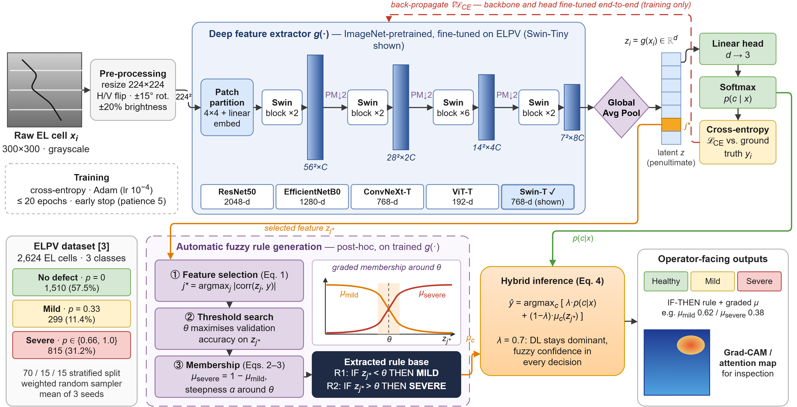
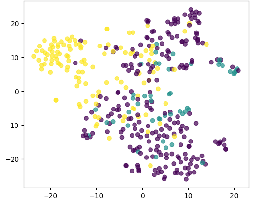
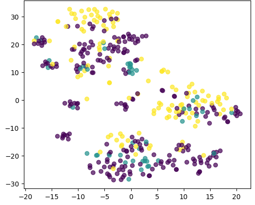
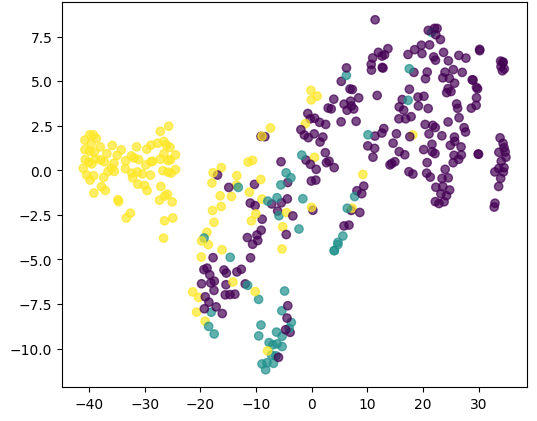
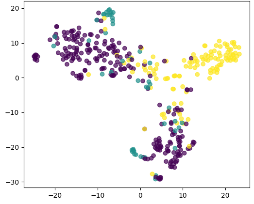
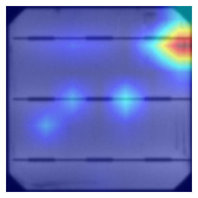
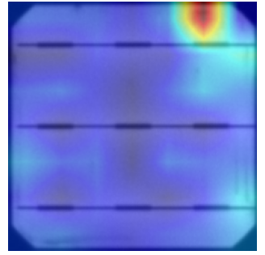

# Interpretable Solar Panel Defect Detection via Fuzzy Rule Extraction from Hierarchical Vision Models

<div align="center">

[](https://python.org)
[](https://pytorch.org)
[](LICENSE)
[](https://www.kaggle.com/datasets/ahmedashrafahmed/elpv-dataset-master)
[](https://icvgip.in/2026/)

**Official implementation of our ICVGIP 2026 paper (ACM ICPS proceedings)**

Latchan Chhetri\*, Aman Kumar\*, Dishant Das, Palash Ghosal†

Sikkim Manipal Institute of Technology, Sikkim Manipal University, India

<sub>\* Equal contribution &nbsp;·&nbsp; † Corresponding author</sub>

</div>

---

## Overview

This repository contains the code for a hybrid **interpretable AI framework** that automatically extracts human-readable **fuzzy IF-THEN rules** from the latent features of trained deep learning models for photovoltaic (PV) defect severity classification on electroluminescence (EL) images.

Most deep learning approaches for PV defect detection are black boxes. Our framework pairs modern vision backbones with a lightweight post-hoc fuzzy rule extractor, so operators receive both a class prediction and a graded, readable rule.

### Key Results (ELPV test set, mean of 3 seeds)

| Model | Accuracy (%) | Feature–Severity \|r\| | Mild Recall (%) | Severe Recall (%) | Params (M) | Inference (ms) |
|-------|:-----------:|:----------------------:|:---------------:|:-----------------:|:----------:|:--------------:|
| **Swin-Tiny** | **80.96** | 0.78 | 48.9 | **87.5** | 28.0 | 22.1 |
| ConvNeXt-Tiny | 80.71 | **0.82** | **51.1** | 81.7 | 28.0 | 18.5 |
| ViT-Tiny | 79.44 | — | 42.6 | 82.5 | 5.7 | 24.3 |
| EfficientNetB0 | 74.62 | 0.42 | 46.8 | 72.5 | 4.0 | 10.8 |
| ResNet50 | 73.60 | 0.64 | 12.8 | 77.5 | 23.5 | 15.2 |

Hierarchical backbones (ConvNeXt-Tiny, Swin-Tiny) give 22–28% higher feature–severity correlation than ResNet50, which yields more reliable fuzzy rules.

---

## Framework Architecture



**Top:** EL cells are pre-processed and encoded by an ImageNet-pretrained backbone *g*(·) (Swin-Tiny shown; five backbones evaluated), fine-tuned end-to-end with cross-entropy.

**Bottom:** Post-hoc fuzzy rule generation selects the most severity-correlated latent feature, searches a threshold θ and defines graded memberships; the rule confidence is fused with the softmax output (λ = 0.7) to give a class prediction, graded membership μ and a Grad-CAM map for operator inspection.

### How It Works

1. **Deep feature extraction**: five backbones (ResNet50, EfficientNetB0, ConvNeXt-Tiny, ViT-Tiny, Swin-Tiny) are fine-tuned on ELPV, and penultimate-layer features *z* = *g*(*x*) are extracted.
2. **Feature selection**: the dimension *j\** with the highest absolute Pearson correlation with the severity label is selected.
3. **Threshold search and membership**: a threshold θ is chosen to maximise validation accuracy on *z<sub>j\*</sub>*; a sigmoid membership with steepness α gives μ<sub>mild</sub>, and μ<sub>severe</sub> = 1 − μ<sub>mild</sub>.
4. **Hybrid inference**: `ŷ = argmax_c [ λ·p(c|x) + (1−λ)·μ_c(z_j*) ]` with λ = 0.7.

### Extracted Fuzzy Rules (Best Models)

```
ConvNeXt-Tiny  (feature f487, |r| = 0.82):
  IF f487 > -19.18  THEN severity is MILD
  IF f487 < -19.18  THEN severity is SEVERE

Swin-Tiny      (feature f101, |r| = 0.78):
  IF f101 < 1.445   THEN severity is MILD
  IF f101 > 1.445   THEN severity is SEVERE
```

|r| is the absolute Pearson correlation between the selected feature and severity. Graded memberships μ are produced around each threshold.

---

## Repository Structure

```
Interpretable-Solar-Defect-Detection/
│
├── FINAL_NOTEBOOK.ipynb       # Complete pipeline: training, fuzzy extraction, visualisation
├── architecture.png           # Framework diagram (Fig. 1 in paper)
├── cm_swin.png                # Swin-Tiny confusion matrix (Fig. 2)
├── tsne_resnet50.png          # t-SNE: ResNet50 (Fig. 3a)
├── tsne_efficientnet.png      # t-SNE: EfficientNetB0 (Fig. 3b)
├── tsne_convnext.png          # t-SNE: ConvNeXt-Tiny (Fig. 3c)
├── tsne_swin.png              # t-SNE: Swin-Tiny (Fig. 3d)
├── gradcam_resnet50.png       # ResNet50 Grad-CAM (Fig. 4a)
├── attn_swin.png              # Swin-Tiny attention map (Fig. 4b)
├── LICENSE
└── README.md
```

---

## Quick Start

### Clone the repo

```bash
git clone https://github.com/Latchan-Ch/Interpretable-Solar-Defect-Detection.git
cd Interpretable-Solar-Defect-Detection
```

### Install dependencies

```bash
pip install torch torchvision timm scikit-learn matplotlib seaborn numpy pandas jupyter
```

### Download the ELPV dataset

Download from [Kaggle](https://www.kaggle.com/datasets/ahmedashrafahmed/elpv-dataset-master) and place it in your working directory.

### Run the notebook

```bash
jupyter notebook FINAL_NOTEBOOK.ipynb
```

The notebook covers:
- Data loading and preprocessing
- Training all five architectures
- Fuzzy rule extraction via Pearson correlation
- t-SNE feature-space visualisation
- Grad-CAM / attention map generation
- Hybrid inference evaluation

---

## Visualisations

### t-SNE Feature Space Comparison

| ResNet50 | EfficientNetB0 | ConvNeXt-Tiny | Swin-Tiny |
|----------|----------------|---------------|-----------|
|  |  |  |  |

*Yellow: No Defect · Purple: Severe Defect · Cyan: Mild Defect*

ConvNeXt-Tiny and Swin-Tiny show cleaner cluster separation, consistent with their higher feature–severity correlation.

### Explainability Maps

| ResNet50 Grad-CAM | Swin-Tiny Attention |
|-------------------|---------------------|
|  |  |

ResNet50 activates narrowly on isolated crack boundaries, whereas Swin-Tiny attends to both the defect and the surrounding cell grid.

---

## Dataset

We use the **ELPV** electroluminescence benchmark (Deitsch et al., 2019; Buerhop-Lutz et al., 2018).

- **2,624** grayscale EL images of solar cells (300×300 px)
- Original labels {0, 0.33, 0.66, 1.0} grouped into 3 severity classes
- Split: 70% train / 15% validation / 15% test (stratified)

| Class | Original label | Samples | Percentage |
|-------|---------------|---------|------------|
| No Defect | 0.0 | 1,510 | 57.5% |
| Mild Defect | 0.33 | 299 | 11.4% |
| Severe Defect | 0.66, 1.0 | 815 | 31.2% |

---

## Training Details

| Setting | Value |
|---------|-------|
| Framework | PyTorch |
| GPU | NVIDIA T4 |
| Input size | 224 × 224 |
| Optimizer | Adam (lr = 1e-4, weight decay = 1e-5) |
| Epochs | up to 20, early stopping (patience 5) |
| Transformer schedule | 5-epoch warmup + cosine annealing |
| Augmentation | H/V flip, rotation ±15°, brightness ±20% |
| Class imbalance | Weighted random sampling |
| Seeds | 3 independent runs (metrics averaged) |
| Fusion weight λ | 0.7 |

---

## Citation

If you use this code or find this work helpful, please cite:

```bibtex
@inproceedings{chhetri2026interpretable,
  title     = {Interpretable Solar Panel Defect Detection via Fuzzy Rule Extraction from Hierarchical Vision Models},
  author    = {Chhetri, Latchan and Kumar, Aman and Das, Dishant and Ghosal, Palash},
  booktitle = {Indian Conference on Computer Vision, Graphics, and Image Processing (ICVGIP 2026)},
  year      = {2026},
  address   = {Kolkata, India},
  publisher = {ACM}
}
```

---

## Contact

- Latchan Chhetri: latchanchhetri19@gmail.com
- Aman Kumar: ak2281198@gmail.com
- Dishant Das: dasdishant5@gmail.com
- Palash Ghosal (corresponding author): ghosalpalash@gmail.com
